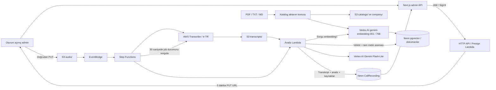

# Görüşme sonrası satış analizi

Admin panelindeki `/call-analytics` sayfası bir müşteriye bağlı telefon kaydını
yükler. Ses dosyası tarayıcıdan doğrudan S3'e gider; Lambda dosyayı taşımaz.
Transkript ve doğrulanan satış analizi mevcut `CallRecording` tablosuna kaydedilir.

## Akış



Embedding modeli `gemini-embedding-001`, boyut 768, bölge `europe-west4`.
Analiz modeli `gemini-3.1-flash-lite`, konum `eu`. İkisi de Vertex AI üzerinden
Google Cloud projesinin faturalandırmasını kullanır. AI Studio API anahtarı,
OpenAI anahtarı, Titan Embeddings, Bedrock Knowledge Base ve S3 Vectors gerekmez.
AWS bölgesi ve mevcut S3 bucket adları korunur. Eski `BEDROCK_MODEL_ID`
ayarı artık kullanılmaz.

## Verilerin korunması

`20261009000000_add_knowledge_vectors` migration'ı `vector` uzantısını,
`KnowledgeDocument` / `KnowledgeChunk` tablolarını, HNSW vektör ve GIN metin
indekslerini ekler. Customer, kategori, görüşme geçmişi ve CallRecording
verilerini değiştirmez. `db:push` yerine versioned migration kullanın;
vektör, oluşturulan tsvector ve kısmi aktif sürüm indeksi SQL'de tanımlıdır.

Her dokümanın mantıksal `sourceKey` değeri, dönemi/sürümü, SHA-256 özeti,
türü (`CATALOG` / `COMPANY`), kaynak S3 adresi, modeli ve parça sayısı tutulur.
Parçaların PDF sayfası korunur. Parçalar en fazla 1200 karakterdir, 180 karakter
örtüşür; modele `autoTruncate=false` gönderilir. Taranmış, metinsiz PDF önce
OCR gerektirir. Dosya sınırı 50 MB / 500 sayfa / 2 milyon metin karakteridir.

Aynı sourceKey + sürüm + içerik + model zaten aktifse yeniden embedding
üretilmez. Yeni sürümün bütün embedding'leri hazırlandıktan ve özgün dosyası
S3'e kaydedildikten sonra tek DB transaction'ıyla yayımlanır. Hata durumunda
eski aktif sürüm aramada kalır. Eski doküman ve parçalar silinmez. Bir sourceKey
başına yalnızca bir aktif sürüme DB indeksiyle izin verilir; eşzamanlı aktarım
aynı sourceKey üzerinde transaction kilidi kullanır. Embedding modeli değişirse
kaynakları yeni modelle tekrar indeksleyin; farklı model vektörleri karıştırılmaz.

Arama anlamsal benzerlikle ürün kodu/kelime eşleşmesini birleştirir. Gemini
önce en fazla üç sorgu üretir, ilgili aktif dokümanları alır, sonra kaynaklarla
satış analizini yapar. CATALOG kaynakları ürün önerileri, COMPANY kaynakları
şirket politikaları için kullanılır. Ürün kodları ve kaynak kimlikleri,
görüşme alıntıları ve zamanları uygulamada ayrıca doğrulanır. Eski fiyatlar
güncel teklif gibi sunulmaz; duygu/satış fırsatı nitel yorumdur.

## Önce kubi: sırasıyla çalıştırın

Komutlar proje kökünden çalıştırılır. `.env` içindeki DATABASE_URL ve
DIRECT_URL **Neon kubi branch'ine** ait olmalı. Stage bağlantı URL'sini
kendiliğinden değiştirmez. Root `.env` yüklenir; varsa `packages/frontend/.env`
aynı şekilde üzerine yazar, iki dosyayı da kontrol edin.

Yerel `.env` için Google değerleri:

```dotenv
GOOGLE_CLOUD_PROJECT="e-aparat-crm"
GOOGLE_CLOUD_LOCATION="europe-west4"
EMBEDDING_MODEL_ID="gemini-embedding-001"
GEMINI_MODEL_ID="gemini-3.1-flash-lite"
GEMINI_LOCATION="eu"
```

Google billing ve Vertex AI API etkin, ADC girişi tamamlanmış olmalı.
SST, yerel worker terminalin HOME değerini devralmadığı için ADC dosyasının
yolunu dev worker'a GOOGLE_APPLICATION_CREDENTIALS olarak açıkça aktarır.
Varsayılan yol `~/.config/gcloud/application_default_credentials.json`;
özel konum için GOOGLE_APPLICATION_CREDENTIALS veya CLOUDSDK_CONFIG kullanın.
Kullanıcının ADC dosyası kendi makinesinde kalır; içeriği AWS'ye gönderilmez.
Deployment ortamına yerel dosya yolu da eklenmez; WIF kullanılır.
Bu kurulum diğer Google projelerinin
faturalandırma bağlantılarını veya kaynaklarını değiştirmez.

1. Bağımlılık ve Google bağlantısı:

```bash
export AWS_PROFILE=eac-prod
export CATEGORY_ENDPOINT="ep-jolly-brook-b2c4tf80.c-6.eu-central-1.aws.neon.tech"

npm install
npm run google:verify
```

`google:verify` kısa sentetik verilerle embedding, JSON ve tam satış analizi
şemasını gerçek Google API'sinde dener. Müşteri/doküman göndermez, DB'ye yazmaz;
küçük model kullanımı ücret/kredi tüketir.

2. Eklemeli migration ve Prisma Client:

```bash
npm run db:migrate:deploy -- \
  --stage kubi \
  --expected-endpoint "$CATEGORY_ENDPOINT"

npm run db:generate
npm run db:status
npm run test:call-analytics
npm run typecheck
npm run typecheck:infra
```

Kategori backfill/contract işlemini tekrar yapmayın. `db:generate` tablo
oluşturmaz; migration ayrı uygulanır. Neon migration'ı SST tarafından çalıştırılmaz.

3. Yerel geliştirme ve AWS kaynaklarının güncellenmesi:

```bash
npx sst dev --stage kubi
```

Bu terminali açık tutun. SST dev AWS kaynaklarını da günceller; önceki
Knowledge Base, data source, S3 Vectors ve ilişkili IAM kaynakları tanımdan
çıkarılmıştır. Mevcut SalesCatalogs ve CallRecordings bucket'ları korunur.
Eski kaynakların kaldırılması, S3'teki özgün PDF/ses kayıtlarını silmez.
Dev dışında deployment için aşağıdaki WIF adımını önce tamamlayın.

Transcribe başlatma Lambda'sı `dev:false` ile SST dev sırasında da AWS'de
çalışır. Böylece çıktı bucket'ı için doğrulanan kimlik, yerel AWS kullanıcısı
yerine S3 Get/Put/List/GetBucketLocation ve PassRole izinleri verilmiş Lambda
rolüdür. Transcribe servis rolünün bucket izinleri ve SourceAccount/SourceArn
trust koşulu da güncellendi. Verdiğiniz S3 erişim hatasına yönelik düzeltme
budur; AWS üzerindeki son doğrulama kısa gerçek ses kaydıyla yapılmalıdır.
Analiz Lambda'sı SST dev'de yerelde çalışır ve Google ADC'yi kullanır.

`Could not load the default credentials` hatasını bu düzeltmeden önce aldıysanız
sst dev'i Ctrl+C ile kapatıp aynı stage'de yeniden başlatın. ADC dosyası mevcutsa
yeniden Google login veya WIF kurulumu gerekmez. Panelde başarısız kayıtta
“Yeniden dene” kullanın; kaydedilmiş transkript yeniden Transcribe edilmez.

4. Başka terminalde katalogları indeksleyin:

S3'teki mevcut iki PDF'in **Object key** değerlerini S3 konsolundan alın.
Her farklı doküman için ayrı sourceKey kullanın; aynı dokümanın güncellenmiş
sürümünde aynı sourceKey'i koruyun.

```bash
npm run catalog:sync -- \
  --stage kubi --expected-endpoint "$CATEGORY_ENDPOINT" \
  --s3-key 'KONSOLDAKI_ILK_PDF_OBJECT_KEY.pdf' \
  --source-key 'bayi-katalogu' --kind catalog \
  --version 'Haziran-Temmuz 2026'
```

Önce dry-run çıktısındaki sayfa/parça ve stage bilgilerini kontrol edin,
ardından aynı komuta `--apply` ekleyin. İkinci PDF için başka sourceKey
(ör. `urun-katalogu`) kullanın. Knowledge Base Sync işlemi artık gerekmez.

Yerel dosya alternatifi:

```bash
npm run catalog:sync -- \
  --stage kubi --expected-endpoint "$CATEGORY_ENDPOINT" \
  --file '/TAM/YOL/KATALOG.pdf' \
  --source-key 'bayi-katalogu' --kind catalog \
  --version 'Haziran-Temmuz 2026' --apply
```

Dry-run Google isteği ve S3/DB yazması yapmaz; yalnızca dosyayı okur ve bucket
stage tag'ini doğrular. `--apply` embedding'leri oluşturur, içerik hash'iyle
S3'e özgün dosyayı kaydeder ve dokümanı aktif yayımlar. `Aktif doküman hazır`
veya `Bu sürüm zaten aktif` çıktısından sonra aramaya hazırdır.

5. Şirket bilgisi ekleyin:

Örneğin `.local/knowledge/sirket-bilgileri.md` dosyasına doğrulanmış teslimat,
numune, iade, iletişim ve satış koşullarını yazın. Gizli müşteri listesi
koymayın; bilmediğiniz koşulları tahmin etmeyin. Gerçek koşullar hazır olana
kadar şirket dokümanı zorunlu değildir.

```bash
npm run catalog:sync -- \
  --stage kubi --expected-endpoint "$CATEGORY_ENDPOINT" \
  --file '.local/knowledge/sirket-bilgileri.md' \
  --source-key 'sirket-politikalari' --kind company \
  --version '2026-10-09' --apply
```

PDF/TXT de aynı şekilde desteklenir. Fiyat veya politika değişirse sürümü
güncelleyin ve aynı sourceKey ile tekrar aktarın.

6. Panelde admin olarak kısa bir kayıt yükleyin. TRANSCRIBING → ANALYZING →
COMPLETED geçişini, transkript/zamanları, ürün kaynakları ve dinlemeyi kontrol
edin. Eski başarısız kayıtta “Yeniden dene” yeni attempt açar; önceki execution'ı
elle tekrar başlatmayın. Kaydedilmiş transkript varsa yeniden Transcribe edilmez.

## AWS deployment için Google WIF

Yerel deneme ADC ile çalışır. `sst deploy` sırasında kişisel ADC dosyasını veya
servis hesabı anahtarı JSON'unu Lambda'ya taşımıyoruz. AWS Lambda rolü Google
Workload Identity Federation ile kısa süreli erişim alır.

İlk `sst dev --stage kubi` kaynak güncellemesi bittikten sonra, başka terminalde:

```bash
npm run google:federation -- --stage kubi
npm run google:federation -- --stage kubi --apply
```

Script `.sst/outputs.json` içindeki güncel analiz Lambda rolünü ve bucket
stage tag'ini kontrol eder. `e-aparat-crm` projesinde stage'e özel pool/provider
ve servis hesabı oluşturur; Vertex AI ve service usage izinlerini servis
hesabına verir. Provider koşulu yalnızca ilgili AWS hesabındaki **analiz
Lambda rolüne** izin verir. Kubi ve production ayrı pool/servis hesabı kullanır.
Google proje IAM / servis hesabı / WIF yönetme yetkileri gerekir.

Provider kimliği `aws-provider` olarak kullanılır; Google kimlikleri 4–32
karakter ister. Eski script'teki üç karakterli `aws` kimliği oluşturulamaz.
Bu hatayı aldıysanız güncel script ile aynı komutu yeniden çalıştırın;
önceden oluşturulan pool ve servis hesabı yeniden kullanılır.

Çıktı `.local/google/wif-kubi.json`: anahtar veya kişisel token içermez ve Git'e
girmez. SST seçili stage'in dosyasını otomatik okur. İsterseniz yolu
GOOGLE_WIF_CONFIG_PATH ile belirtin; stage/proje eşleşmesi kontrol edilir.
Script tekrar çalıştırılabilir, oluşturulmuş kaynakları yeniden kullanır.
SST analiz rolü değişirse güncel çıktılarla script'i tekrar çalıştırın.

İlk kurulumda henüz oluşturulmamış provider'a `describe` çağrısı Google IAM'den
`PERMISSION_DENIED ... (or it may not exist)` döndürebilir. Script varlık
kontrolünü üst kaynağın listesi üzerinden yapar; gerçek listeleme yetkisi hatası
varsa işlemi durdurur. Bu hata eski script'te oluştuysa güncel kodla aynı komutu
yeniden çalıştırın; pool veya servis hesabını silmeniz gerekmez.

`AWS_PROFILE` değerini her terminalde ayrı ayarlayın (`AWS_ROFILE` yanlış yazım).
Yerel SST terminalinde `export AWS_PROFILE=eac-prod` ve ardından
`npx sst dev --stage kubi` çalıştırılır; diğer terminalde aynı export'tan sonra
`npm run google:federation -- --stage kubi --apply` çalıştırılır.

SST dev'i kapattıktan sonra:

```bash
npx sst deploy --stage kubi
```

Deployment sonunda kısa bir görüşmeyle **AWS Lambda → Google WIF** akışını da
denenmiş sayın. Yerel ADC testi WIF erişimini doğrulamaz. IAM değişikliklerinin
yayılması birkaç dakika sürebilir; bu durumda kayıtta yeniden deneme kullanın.

## Production'a geçiş

Önce kubi üzerinde migration, indeksleme, gerçek ses ve WIF testleri tamamlanır.
Production için `.env` DATABASE_URL/DIRECT_URL değerlerini Neon main branch'ine
çevirin ve production SST çıktılarıyla stage'e özel WIF hazırlayın. İlk kurulumda
yerel `sst dev --stage production` kullanmayın; mevcut production analiz Lambda
rolünü AWS çıktılarından belirleyip production'a ait outputs dosyasına
`callAnalysisRoleArn`, `googleCloudProject`, `salesCatalogBucket` ve
`callAnalyticsRegion` ekleyerek `--outputs` ile kurulum script'ine verin.
Bucket stage tag'i ayrıca doğrulanır. Sonraki deploy'lar bu alanları otomatik verir.

```bash
npm run google:federation -- --stage production --outputs .local/production-outputs.json --apply

npm run db:migrate:deploy -- \
  --stage production \
  --expected-endpoint ep-summer-leaf-b2c0ajdt.c-6.eu-central-1.aws.neon.tech

npm run db:generate
npx sst deploy --stage production
```

Katalog/şirket aktarımını production endpoint, stage ve güncel outputs ile
tekrarlayın. Kubi ile production farklı Neon branch'leridir; indeksleri paylaşmaz.
Bu çalışma production migration veya deploy'u otomatik çalıştırmaz.

## Erişim, hata ve kapsam

- Admin kontrolü Next.js sayfası/API'lerinde; HTTP API route'ları IAM auth kullanır.
- Bucket'lar özel, HTTPS zorunlu ve SSE-S3 şifreli. Presigned URL süreli imzalı yetkidir.
- PUT boyut/Content-Type ve If-None-Match ile imzalanır; sesin üzerine yazılamaz.
- Ses: MP3, WAV, FLAC, M4A, MP4, OGG, WEBM, AMR; en fazla 200 MB / iki saat.
- S3: `audio/{id}/recording.{format}`, `transcripts/{id}/attempt-{n}.json`.
- Türkçe için standart Transcribe batch kullanılır; Call Analytics Türkçe desteklemez.
- Duygu ve temsilci değerlendirmesi Gemini yorumudur; ölçülmüş memnuniyet yüzdesi değildir.
- Transkript, doküman ve müşteri bilgileri modele veri olarak verilir; içlerindeki talimatlar dikkate alınmaz.
- Step Functions payload'ına ses/transkript girmez. Dosyalar S3/DB'den okunur.
- DB sahiplenme ve attempt/execution kontrolü tekrar gelen olayların çift sonuç yazmasını önler.
- Timeout/abort durumları FAILED olur; EventBridge teslim hataları DLQ'ya gider.
- CUSTOMER_WRITES_PAUSED yeni yüklemeyi/tekrar denemeyi durdurur; mevcut worker'ları durdurmaz.
- Customer.callCount/lastContactedAt/interestStatus ve manuel notlar otomatik değiştirilmez.
- Model, prompt sürümü, analiz giriş/çıkış token sayıları ve kullanılan kaynaklar kayıtla saklanır.
- Şirket dokümanı eklemek CLI'dandır; mevcut admin sayfası ses yükleme/analiz içindir.
- Kotalar kaldırılmaz: Google modelleri ve AWS Transcribe'ın hesap/bölge kotaları vardır.
  Bu geçiş Bedrock'taki sıfır kotaya bağımlılığı kaldırır.

Offline testler gerçek PostgreSQL motoru (PGlite + pgvector) üzerinde eklemeli
migration, idempotency, eski sürüm/başarısız aktarım koruması, hibrit arama ve
analiz kaydını doğrular. AWS/Google istemcileri mock edilir; bu testler ücretli
çağrı yapmaz. `google:verify` gerçek Google çağrısı yapar. Gerçek ses/Neon/SST/WIF
uçtan uca kontrolü deployment sonrasında yapılmalıdır.

## Resmî kaynaklar

- [Google embedding API ve task/boyut ayarları](https://docs.cloud.google.com/vertex-ai/generative-ai/docs/model-reference/text-embeddings-api)
- [Gemini Flash-Lite model ve konum desteği](https://docs.cloud.google.com/vertex-ai/generative-ai/docs/models/gemini/3-1-flash-lite)
- [AWS kimliğiyle Google WIF](https://docs.cloud.google.com/iam/docs/workload-identity-federation-with-other-clouds)
- [Transcribe IAM ve S3 izinleri](https://docs.aws.amazon.com/transcribe/latest/dg/security_iam_id-based-policy-examples.html)
- [Transcribe StartTranscriptionJob](https://docs.aws.amazon.com/transcribe/latest/APIReference/API_StartTranscriptionJob.html)
- [Neon pgvector](https://neon.com/docs/extensions/pgvector)
