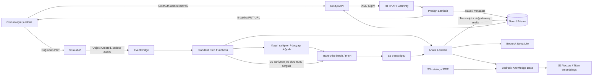

# Görüşme sonrası satış analizi

Admin panelindeki `/call-analytics` sayfası, bir müşteriye bağlı telefon kaydını
yükler ve görüşmenin satış değerlendirmesini gösterir. Dashboard'daki
“Görüşme Analizleri” ve müşteri detayındaki “Görüşme kayıtları ve analizleri”
bağlantıları bu sayfayı açar.

## Akış



Türkçe (`tr-TR`) standart Transcribe batch tarafından desteklenir;
Transcribe Call Analytics Türkçe desteklemez. Konuşmacı ayrımı standart
Transcribe ile, ihtiyaç, yaklaşım, itiraz ve satış değerlendirmesi Bedrock ile
yapılır. Duygu değerlendirmesi nitel bir model yorumudur; ölçülmüş memnuniyet
yüzdesi üretilmez.

Varsayılan model `eu.amazon.nova-lite-v1:0`; `BEDROCK_MODEL_ID` ile değişir.
Bu EU inference profile çağrıları AWS'nin desteklediği AB bölgelerine
yönlendirilebilir. Mevcut SST AWS bölgesi korunur (projedeki son deployment
`eu-west-1`). Kaynakların desteklendiği bölge ve model erişimi deploy edilen
hesapta bulunmalıdır. OpenSearch/Aurora kümesi açılmaz; Knowledge Base'in
vektör deposu S3 Vectors'tır.

## Kayıtlar ve analiz

Eklemeli `20261006000000_add_call_recordings` migration'ı `CallRecording`
tablosunu ve durum enum'unu ekler. `Customer.callRecordings` ilişkisi mevcut
müşterilere dokunmaz. Müşteri kategorileri ve görüşme geçmişi korunur.
Yükleme, müşterinin `callCount`, `lastContactedAt`, `interestStatus` veya
manuel notlarını otomatik değiştirmez.

Bir kayıtta müşteri, temsilci adı, görüşme tarihi, dosya metadata'sı,
yükleyen admin, durum, deneme numarası, workflow/job kimlikleri, transkript,
zamanlı konuşmacı segmentleri, süre ve transkripsiyon güveni tutulur.
Analiz JSON'u şu bilgileri içerir:

- Özet, müşteri ihtiyaçları, görüşme sonucu ve itirazlar.
- Gerekçeli müşteri yaklaşımı ve satış fırsatı.
- Temsilcinin güçlü yönleri ve geliştirebileceği noktalar.
- Sorumlu ve varsa zaman bilgisiyle takip adımları.
- Katalog kaynağı, ürün kodu ve fiyat doğrulama notuyla ürün önerileri.
- Transkriptte doğrulanan alıntılar ve belirsizlikler.

Model, prompt sürümü, token kullanımı ve kullanılan katalog alıntıları da
saklanır. Tamamlama ve yükleme işlemleri müşteri ActivityLog'una eklenir.

## Dosyalar ve erişim

- S3: `audio/{recordingId}/recording.{format}` ve
  `transcripts/{recordingId}/attempt-{attempt}.json`.
- Destek: MP3, WAV, FLAC, M4A, MP4, OGG, WEBM, AMR; en fazla 200 MB.
  İki saat sınırı transkript oluşturulduktan sonra doğrulanır; uzun dosyayı
  baştan bölmek gereksiz Transcribe ücretini önler.
- Ortak kanalda iki konuşmacı için diarization; ayrı müşteri/temsilci
  kanalları varsa channel identification seçilir. Konuşmacı etiketi kişinin
  kimliğini doğrulamaz.
- Bucket'lar özel, HTTPS zorunlu ve SSE-S3 ile şifrelidir. Presigned URL
  şifreleme yöntemi değildir; süreli ve imzalı erişim yetkisidir.
- Presigned PUT boyut ve Content-Type ile imzalanır; `If-None-Match: *`
  mevcut sesin üzerine yazılmasını engeller. URL 5 dakika geçerlidir.
- Panelin her API'sinde admin kontrolü vardır. Browser, API Gateway için
  AWS credential almaz. Next.js sunucusu IAM ile imzalı istek gönderir;
  Gateway route'ları da IAM auth gerektirir.
- Kayıt dinlemek için admin'e 5 dakika geçerli GET URL verilir.
- CORS yalnızca SST web adresini, dev sırasında localhost'u ve açıkça
  belirtilen `CALL_RECORDINGS_ALLOWED_ORIGINS` adreslerini kabul eder.
- `CUSTOMER_WRITES_PAUSED=true` yeni yükleme ve tekrar denemeyi durdurur.
  Daha önce başlamış worker'lar tamamlanabilir; tüm DB yazmalarını durdurmak
  gerektiğinde workflow'ları da durdurun.
- Step Functions payload'larında yalnızca iş kimlikleri ve dosya metadata'sı
  taşınır; transkript ve analiz Lambda tarafından doğrudan S3/DB'den okunur.

## Hata ve tekrar deneme

S3/EventBridge en az bir kez teslim yapabilir. DB satırı kilitlenerek yalnızca
bir execution kaydı sahiplenir; tekrar gelen olaylar sona erer. Lambda
tekrarı aynı deterministik Transcribe job adını kullanır. Terminal workflow
olayları zaman aşımı ve iptal durumlarını da `FAILED` olarak kaydeder.

Panel, PUT tamamlandıktan sonra idempotent bir dispatch de yapar. Bu, S3
olayı gecikirse kaydı başlatır. S3 olayı ve dispatch aynı anda gelse de yalnızca
bir workflow iş yapar. “Analizi başlat” bu dispatch'i yeniden çağırabilir.

Başarısız kayıt “Yeniden dene” ile yeni attempt alır. Transkript daha önce
DB'ye kaydedildiyse tekrar Transcribe ücreti oluşturmadan analiz aşaması
tekrarlanır. Eski execution yeni attempt'in sonucunu değiştiremez.
EventBridge → State Machine teslim hataları 14 gün tutulan SQS dead-letter
queue'ya gider; queue URL'si SST çıktılarındadır.

Kayıt yüklemesi yarım kalırsa satır `UPLOADING` kalır; ses yokken Başlat
işlemi açıklayıcı hata verir. Dosyayı yeni kayıt olarak tekrar yükleyin.
Ses/transkript için otomatik silme süresi tanımlanmamıştır.

## Katalog

İncelenen E-APARAT PDF'i 63 sayfa ve Haziran–Temmuz 2026 bayi fiyat
listesidir. Ürün gruplarında profil tapaları, rotil sistemleri, panel çit
aksesuarları, cıvatalı ayaklar, tutamaklar, tekerlekler, mobilya bağlantıları,
ayaklar, kulplar, medikal ve bahçe mobilya aksesuarları bulunur.

PDF doğrudan kaynak bucket'a yüklenir ve Bedrock ingestion ile indekslenir.
Dosya hash'i, özgün adı ve katalog dönemi metadata'ya yazılır. PDF veya
fiyat listesi Git'e eklenmez. Aynı PDF tekrar yüklendiğinde aynı anahtar
kullanılır. Farklı bir fiyat listesi eski PDF'i otomatik silmez: artık geçerli
olmayan `catalogs/` dosyasını S3'ten kaldırıp data source'u yeniden sync edin.

Bedrock önce görüşmeden en fazla üç ürün arama sorgusu çıkarır, katalogdan
ilgili alıntıları getirir, ardından kaynaklarla analiz üretir. Kaynak yoksa
ürün önerisi oluşturmaz. Kaynak kimlikleri, ürün kodları, alıntılar ve zaman
bilgileri uygulama tarafından doğrulanır. Tarihli fiyatın güncel teklif olduğu
veya adet/bayi iskontolarının birlikte uygulanacağı varsayılmaz. PDF tablo
ayrıştırmasının doğru olduğundan ilk birkaç gerçek analizde emin olun.

## Kubi kurulumu ve doğrulama

Proje kökünden çalıştırın. `.env` içindeki **DATABASE_URL ve DIRECT_URL'yi
Neon kubi branch'ine** ayarlayın. `--stage` bağlantı URL'sini değiştirmez;
`--expected-endpoint` yanlış DB'ye migration uygulanmasını önler.

```bash
export AWS_PROFILE=ceyhunlar-prod
export POST_CALL_ANALYTICS_ENABLED=true
export BEDROCK_MODEL_ID=eu.amazon.nova-lite-v1:0

npm install
npm run db:generate
npm run test:call-analytics
npm run typecheck
npm run typecheck:infra

npm run db:migrate:deploy -- \
  --stage kubi \
  --expected-endpoint ep-jolly-brook-b2c4tf80.c-6.eu-central-1.aws.neon.tech

npx sst deploy --stage kubi
```

Bu migration eklemelidir; kategori backfill/contract işlemini tekrar yapmayın.
Panelde `public.CallRecording does not exist` hatası görülürse uygulamanın
bağlandığı Neon branch'inde bu migration henüz uygulanmamıştır. `sst deploy`
AWS kaynaklarını oluşturur, Neon migration'ını çalıştırmaz; `db:generate`
yalnızca Prisma Client üretir. Yukarıdaki `db:migrate:deploy` komutunu
çalıştırdıktan sonra `npm run db:status` ile kontrol edin. `.env` değiştiyse
`sst dev` / Next.js sürecini yeniden başlatın.
SST çıktıları `callRecordingsBucket`, `salesCatalogBucket`,
`salesKnowledgeBaseId`, `salesCatalogDataSourceId`, `callAnalyticsRegion`
ve State Machine/API adreslerini içerir. Deploy sonucunda `.sst/outputs.json`
doğru stage'in çıktısı olmalıdır; katalog script'i bucket stage tag'ini ayrıca
kontrol eder.

Makinede bulunan katalog dosyası adı aşağıdaki gibidir; sizin makinenizdeki
ad farklıysa `--file` değerini değiştirin.

```bash
npm run catalog:sync -- \
  --stage kubi \
  --file '/Users/kubilayuysal/Downloads/E-APARAT BAYİ KATALOĞU & FİYAT LİSTESİ.pdf' \
  --version 'Haziran-Temmuz 2026'

npm run catalog:sync -- \
  --stage kubi \
  --file '/Users/kubilayuysal/Downloads/E-APARAT BAYİ KATALOĞU & FİYAT LİSTESİ.pdf' \
  --version 'Haziran-Temmuz 2026' \
  --apply
```

İlk komut dry-run'dır; ikincisi PDF'i AWS'ye yükler ve indeksleme durumunu
bekler. `COMPLETE` olmadan katalog hazır değildir. AWS hesabında Nova Lite
ve Titan Text Embeddings v2 erişimi gerekir. Yetki hatalarında Bedrock model
erişimini ve IAM/SCP kısıtlarını kontrol edin.

Kubi panelinde admin ile bir müşteriyi seçin ve kısa Türkçe kayıt yükleyin.
TRANSCRIBING → ANALYZING → COMPLETED durumlarını, konuşmacı/zamanlarını,
ürün kaynaklarını ve kaydı dinlemeyi kontrol edin. İlgisiz ürün içeren ve
boş/sessiz bir kayıtla belirsizlik/hata davranışını da doğrulayın. Giriş
yapmadan sayfa login'e yönlenmeli, API'ler 401 döndürmelidir.

Yerel çalışma için `npx sst dev --stage kubi` kullanın; bağımsız Next.js
çalıştırılacaksa `CALL_RECORDING_API_URL` ve `CALL_ANALYTICS_REGION`
değerlerinin SST çıktılarıyla eşleşmesi ve AWS profile'ın invoke izni olması
gerekir. Browser'a bu credential'lar gönderilmez.

## Production sırası

Kubi denemeleri tamamlanınca `.env`'i Neon production main URL'lerine
çevirin. AWS ücretli kaynaklarını oluşturan deploy ve katalog yüklemesini
terminalden siz çalıştırın.

```bash
npm run db:migrate:deploy -- \
  --stage production \
  --expected-endpoint ep-summer-leaf-b2c0ajdt.c-6.eu-central-1.aws.neon.tech

npx sst deploy --stage production

npm run catalog:sync -- \
  --stage production \
  --file '/Users/kubilayuysal/Downloads/E-APARAT BAYİ KATALOĞU & FİYAT LİSTESİ.pdf' \
  --version 'Haziran-Temmuz 2026' \
  --apply
```

İndeksleme tamamlandıktan sonra production'da kısa bir görüşmeyle uçtan uca
doğrulayın. Geri dönüş için önce `POST_CALL_ANALYTICS_ENABLED=false` ile
uygulamayı deploy ederek yeni yüklemeleri kapatın. Mevcut workflow'ları
tamamlayın veya durdurun. Production retain politikası kayıtları korur;
`CallRecording` tablosunu geri dönüş sırasında silmeyin.

## Maliyet ve kapsam

Transcribe ses süresine, Bedrock sorgu/analiz ve embedding token'larına,
S3/Vectors depolama ve sorgularına, Step Functions adımlarına göre ücret
oluşturur. Modelin giriş/çıkış token sayıları DB'de tutulur. Kesin fiyatlar
bölge ve AWS fiyatlandırmasına göre değişir. Bu uygulama AWS'ye deploy
edilmeden ve gerçek sesle denenmeden hesabın erişim/kota/IAM koşulları için
uçtan uca doğrulanmış sayılmaz.

Testler gerçek PostgreSQL motoru (PGlite) üzerinde migration, idempotent
sahiplenme, eski execution koruması ve analiz kaydını; mock AWS istemcileriyle
presign, Transcribe ve Bedrock akışını doğrular. Testler ücretli AWS çağrısı
yapmaz.

## AWS referansları

- [Transcribe dil desteği](https://docs.aws.amazon.com/transcribe/latest/dg/supported-languages.html)
- [Transcribe job / OutputKey](https://docs.aws.amazon.com/transcribe/latest/APIReference/API_StartTranscriptionJob.html)
- [Nova tool şeması ve desteklenen alanlar](https://docs.aws.amazon.com/nova/latest/userguide/tools-troubleshooting.html)
- [Knowledge Base için S3 Vectors kurulumu](https://docs.aws.amazon.com/bedrock/latest/userguide/knowledge-base-setup.html)
- [Knowledge Base servis rolü](https://docs.aws.amazon.com/bedrock/latest/userguide/kb-permissions.html)
- [S3 Vectors bölge desteği](https://docs.aws.amazon.com/AmazonS3/latest/userguide/s3-vectors-regions-quotas.html)
- [EU Nova Lite inference bölgeleri](https://docs.aws.amazon.com/bedrock/latest/userguide/inference-profiles-support.html)
